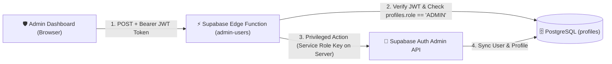

# 🎓 BTA Homeworks — საშინაო დავალებების პორტალი

> **ბიზნესისა და ტექნოლოგიების აკადემიის (BTA)** სასწავლო პროცესის, საშინაო დავალებების ჩაბარებისა და შეფასების თანამედროვე, მარტივი და დაცული ციფრული პლატფორმა.

[](https://react.dev/)
[](https://www.typescriptlang.org/)
[](https://vitejs.dev/)
[](https://tailwindcss.com/)
[](https://supabase.com/)
[](https://vercel.com/)
[]()

---

## 💡 საიტის მთავარი აზრი და ფილოსოფია

**BTA Homeworks**-ის შექმნის მთავარი იდეა არის **სიმარტივე, სისწრაფე და სასწავლო პროცესის გამჭვირვალობა**.

ბევრი სასწავლო პლატფორმა გადატვირთულია რთული მენიუებითა და გაუგებარი ფუნქციებით, რაც ართულებს როგორც მოსწავლის, ისე მასწავლებლის ყოველდღიურ მუშაობას. ამ პორტალის მიზანია:

1. **მაქსიმალური სიმარტივე (Simplicity First):** მომხმარებელი შესვლისთანავე ხვდება პირდაპირ თავის სამუშაო დაფაზე (Dashboard) და ზედმეტი ნაბიჯების გარეშე, 1–2 კლიკით ასრულებს მთავარ მოქმედებას — ნახულობს დავალებას, ტვირთავს ნაშრომს ან აფასებს სტუდენტს.
2. **ყველაფერი ერთ სივრცეში:** მიმოფანტული ჩატების, მეილებისა და სხვადასხვა ბმულების ნაცვლად, ყველა საგანი, დავალების პირობა, მიმაგრებული მასალა, დედლაინი, ჩაბარებული ფაილი, Google Drive/Docs ბმული, ქულა (1–10) და მასწავლებლის კომენტარი თავმოყრილია ერთ სუფთა და მოწესრიგებულ გარემოში.
3. **მკაფიო ვიზუალური სტატუსები:** ფერებითა და ბეიჯებით მოსწავლეც და მასწავლებელიც მყისიერად ხედავს, რომელი დავალებაა ჩასაბარებელი, რომელია მოლოდინში (`SUBMITTED`), რომელი დადასტურდა (`APPROVED`) და რომელი საჭიროებს ჩასწორებას (`DECLINED`).
4. **დახურული და უსაფრთხო აკადემიური სივრცე:** საიტი მუშაობს **Whitelist (თეთრი სიის)** პრინციპით — სისტემაში ხვდებიან მხოლოდ ადმინისტრაციის მიერ დამატებული რეალური მოსწავლეები და მასწავლებლები.
5. **კომფორტი ნებისმიერ მოწყობილობაზე:** საიტი სრულად ადაპტირებულია როგორც კომპიუტერისთვის, ისე მობილურისთვის (მოსწავლეს შეუძლია ტელეფონით პირდაპირ გადაუღოს ფოტო რვეულს და ატვირთოს) და აქვს სრულყოფილი **Light / Dark Mode** მხარდაჭერა.

---

## 🛠️ ტექნოლოგიური სტეკი (რას იყენებს პროექტი)

პროექტი აგებულია თანამედროვე, სწრაფ და უსაფრთხო **Full-Stack Serverless** არქიტექტურაზე:

### 🎨 1. Frontend (კლიენტის მხარე და ფრეიმვორკები)
| ტექნოლოგია | ვერსია | დანიშნულება პროექტში |
|---|---|---|
| **React** | `18.3.1` | მთავარი UI ბიბლიოთეკა/ფრეიმვორკი კომპონენტური არქიტექტურისთვის (`Hooks`, `Context API`, `React.lazy`, `Suspense`). |
| **TypeScript** | `5.6.3` | მკაცრი სტატიკური ტიპიზაცია (`strict: true`, zero `any`), რაც გამორიცხავს ტიპურ შეცდომებს კოდში. |
| **Vite** | `5.4.11` | ულტრასწრაფი ბილდ-ინსტრუმენტი, დეველოპმენტ სერვერი (HMR) და Route-level Code Splitting. |
| **Tailwind CSS** | `3.4.14` | Utility-first CSS ფრეიმვორკი თანამედროვე დიზაინის, რესპონსიულობისა და Dark/Light თემებისთვის (`PostCSS` + `Autoprefixer`). |
| **Wouter** | `3.3.5` | მსუბუქი და სწრაფი როუტერი SPA ნავიგაციისთვის და როლებზე დაფუძნებული `<ProtectedRoute>` დაცვისთვის. |
| **Lucide React** | `0.453.0` | თანამედროვე, სუფთა ვექტორული ხატულების (Icons) ნაკრები. |
| **Browser Image Compression** | `2.0.2` | სურათების ავტომატური კომპრესია ბრაუზერშივე ატვირთვამდე (ზოგავს ინტერნეტ-ტრაფიკს და აჩქარებს ატვირთვას). |
| **clsx & tailwind-merge** | `2.1` / `2.5` | დინამიკური და პირობითი Tailwind კლასების სუფთა მართვა. |
| **Google Fonts** | `Noto Sans Georgian`, `DM Sans` | ქართული და ლათინური ტექსტის სუფთა და კითხვადი ტიპოგრაფია. |

---

### ⚙️ 2. Backend (სერვერული ლოგიკა და API)
პროექტი Backend-ისთვის იყენებს **Supabase (Backend-as-a-Service)** ეკოსისტემას:

- **Supabase Client SDK (`@supabase/supabase-js v2.116.0`):** უზრუნველყოფს კლიენტსა და სერვერს შორის პარალელურ (`Promise.all`) და დაცულ კომუნიკაციას.
- **Supabase Edge Functions (Deno Runtime + TypeScript):**
  - მდებარეობა: `supabase/functions/admin-users/index.ts`
  - დანიშნულება: ასრულებს პრივილეგირებულ ადმინისტრაციულ ოპერაციებს (მომხმარებლის შექმნა, რედაქტირება, პაროლის შეცვლა, წაშლა) სერვერის მხარეს. ამოწმებს გამომძახებლის JWT ტოკენს და `ADMIN` როლს, რათა `service_role` გასაღები არასდროს მოხვდეს ბრაუზერში.
- **Supabase Auth (GoTrue):**
  - ელფოსტითა და პაროლით ავტორიზაცია.
  - JWT სესიების ავტომატური განახლება.
  - პაროლის აღდგენის სისტემა (`resetPasswordForEmail`).
- **Supabase Storage (`homework-files` bucket):**
  - დაცული (Private) ფაილური საცავი მოსწავლეების ნაშრომებისა და მასწავლებლის მასალებისთვის.
  - ფაილები ინახება იზოლირებულად: `{studentId}/{uuid}.{ext}`.
  - ფაილების გასახსნელად გამოიყენება დროებითი დაცული ბმულები (`createSignedUrl` — 1-საათიანი ვალიდურობით).
  - მოწმდება როგორც ფაილის გაფართოება, ისე რეალური MIME ტიპი და მასწავლებლის მიერ დაშვებული ფორმატები (`allowedFormats`).

---

### 🗄️ 3. მონაცემთა ბაზა (Database — PostgreSQL)
მონაცემთა ბაზისთვის გამოიყენება **PostgreSQL** (Supabase-ის მართვადი Postgres ბაზა), რომელიც მოიცავს 4 ძირითად ცხრილს და სერვერულ დაცვას:

1. **`public.profiles`** — მომხმარებელთა პროფილები (`id`, `role` [`ADMIN` | `TEACHER` | `STUDENT`], `name`, `email`, `grade`, `subject`, `phone`).
2. **`public.subjects`** — სასწავლო საგნები (`id`, `name`, `color`, `icon`, `teacher_id`).
3. **`public.assignments`** — მასწავლებლის მიერ შექმნილი დავალებები (`id`, `subject_id`, `teacher_id`, `title`, `description`, `due_date`, `attachment_url`, `allowed_formats`).
4. **`public.submissions`** — მოსწავლეების მიერ ჩაბარებული ნაშრომები (`id`, `assignment_id`, `student_id`, `file_url`, `submission_link`, `student_comment`, `status`, `grade` [1–10], `teacher_feedback`, `submitted_at`, `reviewed_at`).

**ბაზის დონეზე ჩაშენებული დაცვა და ოპტიმიზაცია (`supabase/migrations/`):**
- **Row-Level Security (RLS):** თითოეულ ცხრილს აქვს მკაცრი წვდომის პოლიტიკა — არაავტორიზებულ (`anon`) მომხმარებელს ბაზასთან წვდომა არ აქვს; მოსწავლე ხედავს მხოლოდ საკუთარ ჩაბარებებს; მასწავლებელი აფასებს მხოლოდ საკუთარი საგნის დავალებებს.
- **PostgreSQL Triggers (PL/pgSQL):**
  - `trg_prevent_unauthorized_profile_updates`: ბლოკავს არა-ადმინის მიერ საკუთარი `role`-ის ან `email`-ის შეცვლას.
  - `trg_enforce_submission_rules`: სერვერულად ამოწმებს დავალების ჩაბარების ვადას (`now() > due_date`), ავტომატურად სვამს სტატუსს `SUBMITTED` და იცავს მოსწავლის ნაშრომსა და მასწავლებლის შეფასებას არასანქცირებული ცვლილებისგან.
- **CHECK Constraints:** ბაზის დონეზე ამოწმებს, რომ ქულა (`grade`) იყოს 1-დან 10-მდე, ხოლო ბმული (`submission_link`) იწყებოდეს მხოლოდ `https://drive.google.com/` ან `https://docs.google.com/`-ით (Stored XSS-ის პრევენცია).
- **B-Tree Indexes:** დამატებულია ინდექსები (`idx_submissions_student_id`, `idx_submissions_assignment_id`, `idx_assignments_subject_id`, `idx_assignments_teacher_id`) სწრაფი მუშაობისთვის.

---

### ☁️ 4. ჰოსტინგი, უსაფრთხოება და ტესტირება (DevOps & QA)
- **Vercel:** ფრონტენდის Production ჰოსტინგი GitHub-თან ავტომატური CI/CD ინტეგრაციით.
- **HTTP Security Headers (`vercel.json`):** კონფიგურირებულია `Content-Security-Policy` (CSP), `X-Frame-Options: DENY`, `X-Content-Type-Options: nosniff`, `Referrer-Policy` და `Permissions-Policy`.
- **ავტომატური E2E ტესტები (`tests/run-all.cjs`):** 4-დონიანი სატესტო სისტემა (23 სატესტო ნაკრები, **141 ავტომატური ტესტი**), რომელიც ამოწმებს უსაფრთხოებას, სასაზღვრო შემთხვევებს, UI კონტრასტს და სამივე როლის სრულ სცენარებს.

---

## 👥 სამი როლის შესაძლებლობები

### 👨‍🎓 მოსწავლე (Student)
- ხედავს ყველა საგანს და თითოეულ საგანში საკუთარ პროგრესს.
- აბარებს დავალებას ფაილით (`PDF`, `DOCX`, `XLSX`, `PPTX`, `JPG/PNG/WebP`, `ZIP/RAR`) ან Google Drive / Google Docs ბმულით.
- ვადის ამოწურვამდე შეუძლია ჩაბარებული დავალების განახლება ან გაუქმება (ძველი ფაილი საცავიდან ავტომატურად იშლება).
- ხედავს მასწავლებლის მიერ დაწერილ ქულას (`X/10`) და დეტალურ კომენტარს.

### 👨‍🏫 მასწავლებელი (Teacher)
- ქმნის, არედაქტირებს და შლის დავალებებს თავის საგნებში.
- უთითებს დედლაინს, სასწავლო მასალას და დაშვებულ ფაილის ფორმატებს (`allowedFormats`).
- ფილტრავს და ეძებს სტუდენტების ნაშრომებს სახელითა და სტატუსით (`ყველა`, `ჩაბარებული`, `დადასტურებული`, `უარყოფილი`, `ჩაუბარებელი`).
- აფასებს ნაშრომს **1–10 ქულიანი სისტემით**, უწერს ინდივიდუალურ კომენტარს და ადასტურებს ან უბრუნებს გადასაკეთებლად.

### 🛡️ ადმინისტრატორი (Admin)
- მართავს აკადემიის საგნებს და აბამს შესაბამის მასწავლებლებს.
- მართავს მომხმარებელთა თეთრ სიას (**Whitelist**) — ამატებს, არედაქტირებს და შლის მოსწავლეებს, მასწავლებლებსა და ადმინისტრატორებს.
- აკონტროლებს პლატფორმის სრულ სტატისტიკას.

---

## 🔗 როგორ მუშაობს ადმინისტრატორთან კავშირი (Admin Connection & Flow)

პროექტში „ადმინთან კავშირი" მოიცავს როგორც **მომხმარებლის მხარეს (საკონტაქტო სისტემა)**, ისე **ტექნიკურ სერვერულ კავშირს (Admin API ↔ Supabase Edge Function)**:

### 1. მომხმარებლის კავშირი ადმინისტრაციასთან და პედაგოგებთან (UI / UX)
- **თეთრ სიაში (Whitelist) მოხვედრა:** რადგან პლატფორმა დახურულია გარე რეგისტრაციისთვის, სტუდენტი ან მასწავლებელი უკავშირდება აკადემიის ადმინისტრაციას, რომელიც ადმინ-პანელიდან უქმნის ვერიფიცირებულ ანგარიშს და გადასცემს ავტორიზაციის მონაცემებს.
- **საკონტაქტო დირექტორია და Whitelist გვერდი (`/whitelist`):**
  - ადმინისტრატორს აქვს სრული წვდომა თეთრი სიის მართვისა და კონტაქტების გვერდზე, სადაც ბარათების სახით ჩანს პერსონალისა და პედაგოგების დეტალური მონაცემები (სახელი, საგანი, ელფოსტა, ტელეფონის ნომერი).
  - ბარათზე დაჭერით იხსნება დეტალური მოდალი პირდაპირი კავშირის ღილაკებით: **ელფოსტის მიწერა (`mailto:`)** და **დარეკვა (`tel:`)**.
- **პროფილისა და საკონტაქტო მონაცემების მართვა (`ProfileModal`):**
  - ნებისმიერ მომხმარებელს შეუძლია საკუთარი პროფილის მოდალში განაახლოს სახელი და ტელეფონის ნომერი, რაც მყისიერად აისახება ბაზაში და ხელმისაწვდომია ადმინისტრაციისთვის.

### 2. ტექნიკური კავშირი: როგორ მუშაობს ადმინ-პანელი სერვერთან
ადმინისტრატორს სჭირდება ისეთი ოპერაციების შესრულება, რაც ჩვეულებრივ მომხმარებელს ეკრძალება (`auth.users` ცხრილში ახალი მომხმარებლის რეგისტრაცია, სხვისი პაროლის ან ელფოსტის შეცვლა, ანგარიშის სრული წაშლა).

უსაფრთხოების მიზნით, ბრაუზერი პირდაპირ **არასდროს** იყენებს `service_role` გასაღებს Production-ში. კავშირი მუშაობს შემდეგი არქიტექტურით:



1. **მოთხოვნის გაგზავნა (`src/lib/api.ts` → `invokeAdminEdgeFunction`):**
   - როცა ადმინი ამატებს, არედაქტირებს ან შლის მომხმარებელს, ფრონტენდი იღებს მიმდინარე სესიის JWT ტოკენს (`supabase.auth.getSession()`) და იძახებს სერვერულ ფუნქციას: `supabase.functions.invoke('admin-users', { body, headers: { Authorization: Bearer <token> } })`.
2. **ორმაგი გადამოწმება სერვერზე (`supabase/functions/admin-users/index.ts`):**
   - Edge Function ჯერ ამოწმებს ტოკენის ნამდვილობას (`callerClient.auth.getUser()`).
   - შემდეგ ამოწმებს `public.profiles` ცხრილში, რომ გამომძახებლის როლი ნამდვილად არის **`ADMIN`**. თუ მომხმარებელი არ არის ადმინი, სერვერი აბრუნებს `403 Forbidden`-ს.
3. **უსაფრთხო შესრულება და Rollback დაცვა:**
   - მხოლოდ ადმინის დადასტურების შემდეგ იყენებს სერვერი შიდა `SUPABASE_SERVICE_ROLE_KEY`-ს:
     - **`addWhitelistUser`:** ქმნის მომხმარებელს `auth.users`-ში (`email_confirm: true`) და ამატებს ჩანაწერს `public.profiles`-ში. თუ პროფილის ჩაწერა რაიმე მიზეზით ვერ მოხერხდა, სერვერი ავტომატურად აკეთებს **Rollback**-ს (შლის შექმნილ Auth მომხმარებელს), რომ ბაზაში „ობოლი" ჩანაწერი არ დარჩეს.
     - **`adminUpdateUser`:** ანახლებს ელფოსტას/პაროლს `auth.admin.updateUserById`-ით და ასინქრონებს პროფილის ველებს (`name`, `role`, `grade`, `subject`, `phone`).
     - **`deleteWhitelistUser`:** შლის მომხმარებელს `auth.admin.deleteUser`-ით, ხოლო `ON DELETE CASCADE` ავტომატურად ასუფთავებს მასთან დაკავშირებულ პროფილსა და მონაცემებს.
4. **ლოკალური დეველოპმენტის ფოლბექი (`src/lib/supabase-admin.ts`):**
   - თუ დეველოპერი პროექტს ტესტავს ლოკალურად Edge Function-ის გარეშე, კოდი ავტომატურად იყენებს იზოლირებულ ფოლბექ-კლიენტს (`storageKey: 'bta-supabase-admin-fallback-token'`), რაც ხელს უწყობს შეუფერხებელ ლოკალურ მუშაობას.

---

## 📂 პროექტის სტრუქტურა

```text
btahomeworks/
├── src/
│   ├── components/          # საერთო კომპონენტები (Navbar, Footer, ProtectedRoute, ProfileModal, DateTimePicker...)
│   ├── context/             # თემის (Light/Dark/System) და დიალოგების პროვაიდერები
│   ├── lib/
│   │   ├── api.ts           # მთავარი API ფუნქციები, ფაილების და URL-ების ვალიდაცია
│   │   ├── supabase.ts      # Supabase-ის მთავარი კლიენტი (Singleton)
│   │   └── supabase-admin.ts# ლოკალური დეველოპმენტის ფოლბექ კლიენტი
│   ├── pages_view/          # გვერდები (Login, Student, Teacher, Admin, Whitelist, Documentation, Privacy, Terms)
│   ├── types/               # მკაცრი TypeScript ინტერფეისები და ტიპები
│   ├── App.tsx              # როუტინგი (React.lazy + Suspense) და სესიის მართვა
│   └── main.tsx             # აპლიკაციის საწყისი წერტილი
├── supabase/
│   ├── functions/
│   │   └── admin-users/     # Deno Edge Function ადმინის ოპერაციებისთვის
│   └── migrations/          # კონსოლიდირებული PostgreSQL სქემა, RLS და ტრიგერები
├── tests/                   # 141 ავტომატური ტესტი (Tier 1–4)
├── index.html               # საწყისი HTML, SEO მეტა-თეგები და FOUC-ის საწინააღმდეგო სკრიპტი
├── vercel.json              # Vercel-ის კონფიგურაცია და HTTP Security Headers
└── vite.config.ts           # Vite-ის კონფიგურაცია
```

---

## 🚀 ლოკალურად გაშვება

1. **დამოკიდებულებების დაყენება:**
   ```bash
   npm install
   ```

2. **`.env` ფაილის კონფიგურაცია:**
   ```env
   VITE_SUPABASE_URL=https://your-project.supabase.co
   VITE_SUPABASE_ANON_KEY=your-public-anon-key
   ```

3. **დეველოპმენტ სერვერის ჩართვა:**
   ```bash
   npm run dev
   ```
   საიტი გაიხსნება მისამართზე: `http://localhost:3000/`

4. **ტესტებისა და ბილდის შემოწმება:**
   ```bash
   node tests/run-all.cjs
   npx tsc --noEmit
   npm run build
   ```

---

## 📄 ლიცენზია
© 2026 **ბიზნესისა და ტექნოლოგიების აკადემია (BTA)**. ყველა უფლება დაცულია.
