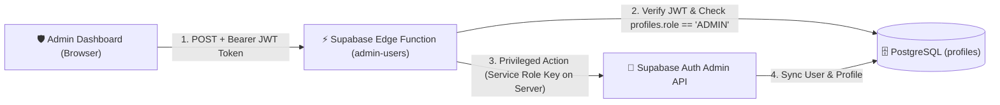

# 🎓 BTA Homeworks — საშინაო დავალებების პორტალი

> **ბიზნესისა და ტექნოლოგიების აკადემიის (BTA)** სასწავლო პროცესის, საშინაო დავალებების ჩაბარებისა და შეფასების თანამედროვე, მარტივი და დაცული ციფრული პლატფორმა.

[](https://react.dev/)
[](https://www.typescriptlang.org/)
[](https://vitejs.dev/)
[](https://tailwindcss.com/)
[](https://supabase.com/)
[](https://vercel.com/)
[]()

---

## 💡 საიტის მთავარი აზრი და ფილოსოფია

**BTA Homeworks**-ის შექმნის მთავარი იდეა არის **სიმარტივე, სისწრაფე და სასწავლო პროცესის გამჭვირვალობა**.

ბევრი სასწავლო პლატფორმა გადატვირთულია რთული მენიუებითა და გაუგებარი ფუნქციებით, რაც ართულებს როგორც მოსწავლის, ისე მასწავლებლის ყოველდღიურ მუშაობას. ამ პორტალის მიზანია:

1. **მაქსიმალური სიმარტივე (Simplicity First):** მომხმარებელი შესვლისთანავე ხვდება პირდაპირ თავის სამუშაო დაფაზე (Dashboard) და ზედმეტი ნაბიჯების გარეშე, 1–2 კლიკით ასრულებს მთავარ მოქმედებას — ნახულობს დავალებას, ტვირთავს ნაშრომს ან აფასებს სტუდენტს.
2. **ყველაფერი ერთ სივრცეში:** მიმოფანტული ჩატების, მეილებისა და სხვადასხვა ბმულების ნაცვლად, ყველა საგანი, დავალების პირობა, მიმაგრებული მასალა, დედლაინი, ჩაბარებული ფაილი, Google Drive/Docs ბმული, ქულა (1–10) და მასწავლებლის კომენტარი თავმოყრილია ერთ სუფთა და მოწესრიგებულ გარემოში.
3. **მკაფიო ვიზუალური სტატუსები:** ფერებითა და ბეიჯებით მოსწავლეც და მასწავლებელიც მყისიერად ხედავს, რომელი დავალებაა ჩასაბარებელი, რომელია მოლოდინში (`SUBMITTED`), რომელი დადასტურდა (`APPROVED`) და რომელი საჭიროებს ჩასწორებას (`DECLINED`).
4. **დახურული და უსაფრთხო აკადემიური სივრცე:** საიტი მუშაობს **Whitelist (თეთრი სიის)** პრინციპით — სისტემაში ხვდებიან მხოლოდ ადმინისტრაციის მიერ დამატებული რეალური მოსწავლეები და მასწავლებლები.
5. **კომფორტი ნებისმიერ მოწყობილობაზე:** საიტი სრულად ადაპტირებულია როგორც კომპიუტერისთვის, ისე მობილურისთვის (მოსწავლეს შეუძლია ტელეფონით პირდაპირ გადაუღოს ფოტო რვეულს და ატვირთოს) და აქვს სრულყოფილი **Light / Dark Mode** მხარდაჭერა.

---

## 🛠️ ტექნოლოგიური სტეკი (რას იყენებს პროექტი)

პროექტი აგებულია თანამედროვე, სწრაფ და უსაფრთხო **Full-Stack Serverless** არქიტექტურაზე:

### 🎨 1. Frontend (კლიენტის მხარე და ფრეიმვორკები)
| ტექნოლოგია | ვერსია | დანიშნულება პროექტში |
|---|---|---|
| **React** | `18.3.1` | მთავარი UI ბიბლიოთეკა/ფრეიმვორკი კომპონენტური არქიტექტურისთვის (`Hooks`, `Context API`, `React.lazy`, `Suspense`). |
| **TypeScript** | `5.6.3` | მკაცრი სტატიკური ტიპიზაცია (`strict: true`; დარჩენილი `any` ეტაპობრივად მცირდება), რაც ამცირებს ტიპურ შეცდომებს კოდში. |
| **Vite** | `5.4.21` | ულტრასწრაფი ბილდ-ინსტრუმენტი, დეველოპმენტ სერვერი (HMR) და Route-level Code Splitting. |
| **Tailwind CSS** | `3.4.14` | Utility-first CSS ფრეიმვორკი თანამედროვე დიზაინის, რესპონსიულობისა და Dark/Light თემებისთვის (`PostCSS` + `Autoprefixer`). |
| **Wouter** | `3.3.5` | მსუბუქი და სწრაფი როუტერი SPA ნავიგაციისთვის და როლებზე დაფუძნებული `<ProtectedRoute>` დაცვისთვის. |
| **Lucide React** | `0.453.0` | თანამედროვე, სუფთა ვექტორული ხატულების (Icons) ნაკრები. |
| **Browser Image Compression** | `2.0.2` | სურათების ავტომატური კომპრესია ბრაუზერშივე ატვირთვამდე (ზოგავს ინტერნეტ-ტრაფიკს და აჩქარებს ატვირთვას). |
| **clsx & tailwind-merge** | `2.1` / `2.5` | დინამიკური და პირობითი Tailwind კლასების სუფთა მართვა. |
| **Google Fonts** | `Noto Sans Georgian`, `DM Sans` | ქართული და ლათინური ტექსტის სუფთა და კითხვადი ტიპოგრაფია. |

---

### ⚙️ 2. Backend (სერვერული ლოგიკა და API)
პროექტი Backend-ისთვის იყენებს **Supabase (Backend-as-a-Service)** ეკოსისტემას:

- **Supabase Client SDK (`@supabase/supabase-js v2.116.0`):** უზრუნველყოფს კლიენტსა და სერვერს შორის პარალელურ (`Promise.all`) და დაცულ კომუნიკაციას.
- **Supabase Edge Functions (Deno Runtime + TypeScript):**
  - მდებარეობა: `supabase/functions/admin-users/index.ts`
  - დანიშნულება: ასრულებს პრივილეგირებულ ადმინისტრაციულ ოპერაციებს (მომხმარებლის შექმნა, რედაქტირება, პაროლის შეცვლა, წაშლა) სერვერის მხარეს. ამოწმებს გამომძახებლის JWT ტოკენს და `ADMIN` როლს, რათა `service_role` გასაღები არასდროს მოხვდეს ბრაუზერში.
- **Supabase Auth (GoTrue):**
  - ელფოსტითა და პაროლით ავტორიზაცია.
  - JWT სესიების ავტომატური განახლება.
  - პაროლის აღდგენის სისტემა (`resetPasswordForEmail`).
- **Supabase Storage (`homework-files` bucket):**
  - დაცული (Private) ფაილური საცავი მოსწავლეების ნაშრომებისა და მასწავლებლის მასალებისთვის.
  - ფაილები ინახება იზოლირებულად: `{studentId}/{uuid}.{ext}`.
  - ფაილების გასახსნელად გამოიყენება დროებითი დაცული ბმულები (`createSignedUrl` — 1-საათიანი ვალიდურობით).
  - მოწმდება როგორც ფაილის გაფართოება, ისე რეალური MIME ტიპი და მასწავლებლის მიერ დაშვებული ფორმატები (`allowedFormats`).

---

### 🗄️ 3. მონაცემთა ბაზა (Database — PostgreSQL)
მონაცემთა ბაზისთვის გამოიყენება **PostgreSQL** (Supabase-ის მართვადი Postgres ბაზა), რომელიც მოიცავს 4 ძირითად ცხრილს და სერვერულ დაცვას:

1. **`public.profiles`** — მომხმარებელთა პროფილები (`id`, `role` [`ADMIN` | `TEACHER` | `STUDENT`], `name`, `email`, `grade`, `subject`, `phone`).
2. **`public.subjects`** — სასწავლო საგნები (`id`, `name`, `color`, `icon`, `teacher_id`).
3. **`public.assignments`** — მასწავლებლის მიერ შექმნილი დავალებები (`id`, `subject_id`, `teacher_id`, `title`, `description`, `due_date`, `attachment_url`, `allowed_formats`).
4. **`public.submissions`** — მოსწავლეების მიერ ჩაბარებული ნაშრომები (`id`, `assignment_id`, `student_id`, `file_url`, `submission_link`, `student_comment`, `status`, `grade` [1–10], `teacher_feedback`, `submitted_at`, `reviewed_at`).

**ბაზის დონეზე ჩაშენებული დაცვა და ოპტიმიზაცია (`supabase/migrations/`):**
- **Row-Level Security (RLS):** თითოეულ ცხრილს აქვს მკაცრი წვდომის პოლიტიკა — არაავტორიზებულ (`anon`) მომხმარებელს ბაზასთან წვდომა არ აქვს; მოსწავლე ხედავს მხოლოდ საკუთარ ჩაბარებებს; მასწავლებელი აფასებს მხოლოდ საკუთარი საგნის დავალებებს.
- **PostgreSQL Triggers (PL/pgSQL):**
  - `trg_prevent_unauthorized_profile_updates`: ბლოკავს არა-ადმინის მიერ საკუთარი `role`-ის ან `email`-ის შეცვლას.
  - `trg_enforce_submission_rules`: სერვერულად ამოწმებს დავალების ჩაბარების ვადას (`now() > due_date`), ავტომატურად სვამს სტატუსს `SUBMITTED` და იცავს მოსწავლის ნაშრომსა და მასწავლებლის შეფასებას არასანქცირებული ცვლილებისგან.
- **CHECK Constraints:** ბაზის დონეზე ამოწმებს, რომ ქულა (`grade`) იყოს 1-დან 10-მდე, ხოლო ბმული (`submission_link`) იწყებოდეს მხოლოდ `https://drive.google.com/` ან `https://docs.google.com/`-ით (Stored XSS-ის პრევენცია).
- **B-Tree Indexes:** დამატებულია ინდექსები (`idx_submissions_student_id`, `idx_submissions_assignment_id`, `idx_assignments_subject_id`, `idx_assignments_teacher_id`) სწრაფი მუშაობისთვის.

---

### ☁️ 4. ჰოსტინგი, უსაფრთხოება და ტესტირება (DevOps & QA)
- **Vercel:** ფრონტენდის Production ჰოსტინგი GitHub-თან ავტომატური CI/CD ინტეგრაციით.
- **HTTP Security Headers (`vercel.json`):** კონფიგურირებულია `Content-Security-Policy` (CSP), `X-Frame-Options: DENY`, `X-Content-Type-Options: nosniff`, `Referrer-Policy` და `Permissions-Policy`.
- **ავტომატური შემოწმებები (`npm test`):** არსებული 141 სტატიკური/სიმულაციური შემოწმება და დამატებული რეგრესიული ტესტები რეალურ API-სა და Edge Function-ის კოდზე. PostgreSQL წესები მოწმდება იზოლირებულ PGlite ბაზაში. ეს ნაკრებები ბრაუზერულ E2E ტესტებს არ ანაცვლებს; აქტიური Supabase გარემო ცალკე უნდა შემოწმდეს.

---

## 👥 სამი როლის შესაძლებლობები

### 👨‍🎓 მოსწავლე (Student)
- ხედავს ყველა საგანს და თითოეულ საგანში საკუთარ პროგრესს.
- აბარებს დავალებას ფაილით (`PDF`, `DOCX`, `XLSX`, `PPTX`, `JPG/PNG/WebP`, `ZIP/RAR`) ან Google Drive / Google Docs ბმულით.
- ვადის ამოწურვამდე შეუძლია ჩაბარებული დავალების განახლება ან გაუქმება (ძველი ფაილი საცავიდან ავტომატურად იშლება).
- ხედავს მასწავლებლის მიერ დაწერილ ქულას (`X/10`) და დეტალურ კომენტარს.

### 👨‍🏫 მასწავლებელი (Teacher)
- ქმნის, არედაქტირებს და შლის დავალებებს თავის საგნებში.
- უთითებს დედლაინს, სასწავლო მასალას და დაშვებულ ფაილის ფორმატებს (`allowedFormats`).
- ფილტრავს და ეძებს სტუდენტების ნაშრომებს სახელითა და სტატუსით (`ყველა`, `ჩაბარებული`, `დადასტურებული`, `უარყოფილი`, `ჩაუბარებელი`).
- აფასებს ნაშრომს **1–10 ქულიანი სისტემით**, უწერს ინდივიდუალურ კომენტარს და ადასტურებს ან უბრუნებს გადასაკეთებლად.

### 🛡️ ადმინისტრატორი (Admin)
- მართავს მომხმარებლებს; საგნების მართვის ინტერფეისი და ჯგუფებზე მიბმა დაგეგმილია. საგნები ამ ეტაპზე ბაზაში იმართება.
- მართავს მომხმარებელთა თეთრ სიას (**Whitelist**) — ამატებს, არედაქტირებს და შლის მოსწავლეებს, მასწავლებლებსა და ადმინისტრატორებს.
- აკონტროლებს პლატფორმის სრულ სტატისტიკას.

---

## 🔗 როგორ მუშაობს ადმინისტრატორთან კავშირი (Admin Connection & Flow)

პროექტში „ადმინთან კავშირი" მოიცავს როგორც **მომხმარებლის მხარეს (საკონტაქტო სისტემა)**, ისე **ტექნიკურ სერვერულ კავშირს (Admin API ↔ Supabase Edge Function)**:

### 1. მომხმარებლის კავშირი ადმინისტრაციასთან და პედაგოგებთან (UI / UX)
- **თეთრ სიაში (Whitelist) მოხვედრა:** რადგან პლატფორმა დახურულია გარე რეგისტრაციისთვის, სტუდენტი ან მასწავლებელი უკავშირდება აკადემიის ადმინისტრაციას, რომელიც ადმინ-პანელიდან აგზავნის მოწვევას მოქმედ ელფოსტაზე. მომხმარებელი ბმულით ადასტურებს მისამართს და თავად ადგენს პაროლს.
- **საკონტაქტო დირექტორია და Whitelist გვერდი (`/whitelist`):**
  - ადმინისტრატორს აქვს სრული წვდომა თეთრი სიის მართვისა და კონტაქტების გვერდზე, სადაც ბარათების სახით ჩანს პერსონალისა და პედაგოგების დეტალური მონაცემები (სახელი, საგანი, ელფოსტა, ტელეფონის ნომერი).
  - ბარათზე დაჭერით იხსნება დეტალური მოდალი პირდაპირი კავშირის ღილაკებით: **ელფოსტის მიწერა (`mailto:`)** და **დარეკვა (`tel:`)**.
- **პროფილისა და საკონტაქტო მონაცემების მართვა (`ProfileModal`):**
  - მომხმარებელს შეუძლია საკუთარი პროფილის მოდალში განაახლოს სახელი, ხოლო მასწავლებელს — ტელეფონის ნომერიც, რაც მყისიერად აისახება ბაზაში და ხელმისაწვდომია ადმინისტრაციისთვის.

### 2. ტექნიკური კავშირი: როგორ მუშაობს ადმინ-პანელი სერვერთან
ადმინისტრატორს სჭირდება ისეთი ოპერაციების შესრულება, რაც ჩვეულებრივ მომხმარებელს ეკრძალება (`auth.users` ცხრილში ახალი მომხმარებლის რეგისტრაცია, სხვისი პაროლის შეცვლა, ანგარიშის სრული წაშლა).

უსაფრთხოების მიზნით, ბრაუზერი პირდაპირ **არასდროს** იყენებს `service_role` გასაღებს Production-ში. კავშირი მუშაობს შემდეგი არქიტექტურით:



1. **მოთხოვნის გაგზავნა (`src/lib/api.ts` → `invokeAdminAction`):**
   - როცა ადმინი ამატებს, არედაქტირებს ან შლის მომხმარებელს, ფრონტენდი იღებს მიმდინარე სესიის JWT ტოკენს (`supabase.auth.getSession()`) და იძახებს სერვერულ ფუნქციას: `supabase.functions.invoke('admin-users', { body, headers: { Authorization: Bearer <token> } })`.
2. **ორმაგი გადამოწმება სერვერზე (`supabase/functions/admin-users/index.ts`):**
   - Edge Function ჯერ ამოწმებს ტოკენის ნამდვილობას (`callerClient.auth.getUser()`).
   - შემდეგ ამოწმებს `public.profiles` ცხრილში, რომ გამომძახებლის როლი ნამდვილად არის **`ADMIN`**. თუ მომხმარებელი არ არის ადმინი, სერვერი აბრუნებს `403 Forbidden`-ს.
3. **უსაფრთხო შესრულება და Rollback დაცვა:**
   - მხოლოდ ადმინის დადასტურების შემდეგ იყენებს სერვერი შიდა `SUPABASE_SERVICE_ROLE_KEY`-ს:
     - **`addWhitelistUser`:** აგზავნის მოწვევას `inviteUserByEmail`-ით და ამატებს პროფილს. ავტომატური დადასტურება და ადმინის მიერ ახალი პაროლის მითითება მოხსნილია. პროფილის შენახვის ჩავარდნისას ანგარიში არ იშლება: შესაძლოა წერილი უკვე გაგზავნილი იყოს ან პარალელურმა მოთხოვნამ პროფილი შექმნას; საჭიროა ადმინისტრაციული შემოწმება.
     - **`adminUpdateUser`:** ანახლებს პაროლსა და პროფილის ველებს (`name`, `role`, `grade`, `subject`, `phone`). განსხვავებული ელფოსტის უშუალოდ შეცვლა აკრძალულია; მომხმარებელი მისამართს საკუთარი პროფილიდან ცვლის და წერილით ადასტურებს.
     - **`deleteWhitelistUser`:** შლის მომხმარებელს `auth.admin.deleteUser`-ით, ხოლო `ON DELETE CASCADE` ავტომატურად ასუფთავებს მასთან დაკავშირებულ პროფილსა და მონაცემებს.
4. **მხოლოდ სერვერული ადმინისტრაციული ოპერაციები:**
   - ბრაუზერში პრივილეგირებული fallback აღარ არსებობს. მომხმარებლების სამართავად საჭიროა განთავსებული `admin-users` Edge Function. `SUPABASE_SERVICE_ROLE_KEY` გამოიყენება მხოლოდ სერვერზე; `VITE_` პრეფიქსით მისი შენახვა დაუშვებელია.


---

## 📂 პროექტის სტრუქტურა

```text
btahomeworks/
├── src/
│   ├── components/          # საერთო კომპონენტები (Navbar, Footer, ProtectedRoute, ProfileModal, DateTimePicker...)
│   ├── context/             # თემის (Light/Dark/System) და დიალოგების პროვაიდერები
│   ├── lib/
│   │   ├── api.ts           # მთავარი API ფუნქციები, ფაილების და URL-ების ვალიდაცია
│   │   ├── supabase.ts      # Supabase-ის მთავარი კლიენტი (Singleton)
│   │   └── useUploadDraft.ts# ფორმის დროებითი ატვირთვების გასუფთავება
│   ├── pages_view/          # გვერდები (Login, Student, Teacher, Admin, Whitelist, Documentation, Privacy, Terms)
│   ├── types/               # მკაცრი TypeScript ინტერფეისები და ტიპები
│   ├── App.tsx              # როუტინგი (React.lazy + Suspense) და სესიის მართვა
│   └── main.tsx             # აპლიკაციის საწყისი წერტილი
├── supabase/
│   ├── functions/
│   │   └── admin-users/     # Deno Edge Function ადმინის ოპერაციებისთვის
│   └── migrations/          # კონსოლიდირებული PostgreSQL სქემა, RLS და ტრიგერები
├── tests/                   # სტატიკური, სიმულაციური და რეალური კოდის რეგრესიული ტესტები
├── index.html               # საწყისი HTML, SEO მეტა-თეგები და FOUC-ის საწინააღმდეგო სკრიპტი
├── vercel.json              # Vercel-ის კონფიგურაცია და HTTP Security Headers
└── vite.config.ts           # Vite-ის კონფიგურაცია
```

---

## 🚀 ლოკალურად გაშვება

1. **დამოკიდებულებების დაყენება:**
   ```bash
   npm install
   ```

2. **`.env` ფაილის კონფიგურაცია:**
   ```env
   VITE_SUPABASE_URL=https://your-project.supabase.co
   VITE_SUPABASE_ANON_KEY=your-public-anon-key
   ```

3. **დეველოპმენტ სერვერის ჩართვა:**
   ```bash
   npm run dev
   ```
   საიტი გაიხსნება მისამართზე: `http://localhost:3000/`

4. **ტესტებისა და ბილდის შემოწმება:**
   ```bash
   npm test
   npx tsc --noEmit
   npm run build
   ```

---

## 📄 ლიცენზია
© 2026 **ბიზნესისა და ტექნოლოგიების აკადემია (BTA)**. ყველა უფლება დაცულია.


## 2026-10-12: უსაფრთხოებისა და საიმედოობის პირველი ეტაპი

- ახალი ფაილები ინახება storage path-ით; ძველი public URL ჩანაწერებიც მხარდაჭერილია. ფაილი იხსნება მხოლოდ მოთხოვნისას შექმნილი, 1-საათიანი signed URL-ით.
- მასწავლებლის მიმაგრებული მასალა ხელმისაწვდომია ავტორიზებული მოსწავლეებისთვის (მიმდინარე საერთო საგნების მოდელის ფარგლებში); სტუდენტის ნაშრომს კითხულობს მხოლოდ მისი დავალების მასწავლებელი, თვითონ სტუდენტი და ადმინისტრატორი.
- ბაზა ბლოკავს ვადის შემდეგ ჩაბარების ცვლილებასა და გაუქმებას. Storage არ შლის ჩანაწერზე მიბმულ ფაილს. შეცვლისას ჯერ ინახება ჩანაწერი და შემდეგ იშლება ძველი ფაილი.
- გაუქმებული ფორმის ახალი ატვირთვები იწმინდება. ქსელის გამო წარუმატებელი cleanup შეიძლება საცავში დარჩეს; პერიოდული orphan-cleanup სამუშაო შემდეგ ეტაპზეა დასამატებელი.
- ფაილის გაფართოება, ზომა და დეკლარირებული MIME მოწმდება; ეს ფაილის შიგთავსის ანტივირუსულ შემოწმებას არ ნიშნავს.
- `/reset-password` ასრულებს აღდგენას. Supabase Auth-ის Redirect URLs-ში დაამატეთ `http://127.0.0.1:3000/reset-password` და production დომენის შესაბამისი URL. მომხმარებელი ითხოვს ახალ ბმულს `/login` გვერდიდან.
- დადასტურებული Auth ელფოსტა ავტომატურად სინქრონდება პროფილში. ადმინის ნაწილობრივი რედაქტირება ინარჩუნებს გამოუგზავნელ ველებს; Auth განახლების ჩავარდნისას პროფილის ცვლილებები უკან ბრუნდება.
- მასწავლებელი მიბმული საგნებით/დავალებებით ვერ წაიშლება, სანამ სასწავლო კავშირები არ გადაიბარება. სტუდენტის ანგარიშის წაშლა კვლავ შლის მის ჩანაწერებს; სრული არქივირება/დეაქტივაცია მომდევნო ეტაპზეა.

### განთავსება

1. შექმენით ბაზის სარეზერვო ასლი და staging გარემოში გადაამოწმეთ არსებული მონაცემები.
2. გამოიყენეთ `20261011000000_consolidated_schema_and_security.sql`, თუ ჯერ არ არის გამოყენებული, შემდეგ `20261012000000_submission_and_storage_integrity.sql`. ახალი მიგრაცია გაუშვით ერთხელ migration history-ით, ან Supabase SQL Editor-ში. ძველი `fix-*.sql` სკრიპტები ახალი მიგრაციის შემდეგ არ გაუშვათ.
3. განაახლეთ Edge Function: `supabase functions deploy admin-users`. CLI-ს უნდა ჰქონდეს შესაბამის პროექტთან კავშირი. სერვერზე საჭიროა `SUPABASE_URL`, `SUPABASE_ANON_KEY` და `SUPABASE_SERVICE_ROLE_KEY`.
4. პირველი ადმინისტრატორი შექმენით Supabase Auth Dashboard-ში და მისი UUID-ით დაამატეთ `profiles` ჩანაწერი `ADMIN` როლით. ბრაუზერში საჯარო რეგისტრაცია არ ჩართოთ.
5. წაშალეთ `VITE_SUPABASE_SERVICE_ROLE_KEY` frontend გარემოდან. თუ ის ადრე გავრცელებულ ბილდში იყო, შეცვალეთ გასაღები და განაახლეთ სერვერის კონფიგურაცია.
6. frontend გამოუშვით მიგრაციისა და Edge Function-ის შემდეგ. სამივე როლით შეამოწმეთ ატვირთვა, მასალის გახსნა, შეფასება და აღდგენის წერილის ბმული.

### ლოკალური შემოწმებები

```bash
npm test
npm run test:regression
npm run typecheck
npm run build
```

მხოლოდ საჯარო კონფიგურაცია ჩაიწერება `.env`-ში (იხილეთ `.env.example`). Dev სერვერი ნაგულისხმევად უსმენს `127.0.0.1`-ს. განსხვავებული მოწყობილობიდან ტესტირებისთვის host-ის შეცვლა ცალკე, მიზნობრივად გააკეთეთ.

დარჩენილი სამუშაო: ჯგუფები/ჩარიცხვები, საგნების მართვის გვერდი, არქივირება, შეტყობინებები, გაფართოებული UX/ვიზუალური ცვლილებები და ბრაუზერული E2E დაფარვა. დამოკიდებულებების audit-ში დარჩენილი build-tool საკითხები მოითხოვს ცალკე შემოწმებულ major-version მიგრაციას.


## რეალური ელფოსტით ახალი ანგარიშები

ადმინისტრატორი ავსებს სახელს, მოქმედ ელფოსტას და როლს. ახალი მომხმარებელი იღებს მოწვევას და `/accept-invite` გვერდზე ადგენს საკუთარ პაროლს. ელფოსტის ფორმატის შემოწმება საფოსტო ყუთის არსებობას ვერ ამტკიცებს — წვდომა დასტურდება მიღებული ბმულით.

არსებული სატესტო მოსწავლეები/მასწავლებლები შენარჩუნებულია: მათი ანგარიშები და დადასტურების დროშები არ შეცვლილა. ახალი მიგრაცია არც ანგარიშებს შლის და არც მათ ელფოსტებს ცვლის. უკვე დადასტურებული სატესტო ანგარიშები მუშაობას აგრძელებენ; არარსებულ მისამართზე აღდგენის წერილის მიღება კვლავ შეუძლებელია.

ამ ცვლილების გასააქტიურებლად:

1. წინა მიგრაციების შემდეგ გამოიყენეთ `supabase/migrations/20261012010000_require_confirmed_email.sql`. RLS დაუდასტურებელ ანგარიშებს სასწავლო მონაცემებსა და ფაილებზე წვდომას უზღუდავს.
2. Supabase Auth-ში ჩართული იყოს **Confirm email** და **Secure email change**. გარე რეგისტრაცია დარჩეს გამორთული — წევრებს კვლავ მხოლოდ ადმინი იწვევს.
3. Supabase Auth-ის **Custom SMTP** გამართეთ მოქმედი ფოსტის სერვისით. ნაგულისხმევი SMTP წერილებს მხოლოდ პროექტის გუნდის მისამართებზე აგზავნის და ყველა მოსწავლისთვის საკმარისი არ არის. [ოფიციალური SMTP ინსტრუქცია](https://supabase.com/docs/guides/auth/auth-smtp).
4. `admin-users` Edge Function-ის server secret `APP_URL` მიუთითეთ საიტის origin-ზე. ადგილობრივი ტესტისთვის: `http://127.0.0.1:3000`; production-ისთვის: თქვენი HTTPS დომენი. იხილეთ `supabase/functions/.env.example`. ეს მნიშვნელობა არ აიღება ბრაუზერის გამოგზავნილი redirect-იდან.
5. Redirect URLs-ში დაამატეთ შესაბამისი `/accept-invite` და `/reset-password` მისამართები. მოწვევის წერილის შაბლონში შეინარჩუნეთ Supabase-ის მოქმედი დადასტურების ბმული.
6. განაახლეთ `admin-users` (`supabase functions deploy admin-users`) და `password-recovery` (`supabase functions deploy password-recovery`), შემდეგ frontend. რეალური ახალი მისამართით შეამოწმეთ წერილის მიღება, ბმული, პაროლის დაყენება და შემდგომი შესვლა. ამ ცვლილების ლოკალური ტესტები წერილებს არ აგზავნის და მოქმედ ბაზას არ ცვლის.

მოწვევისას ანგარიში წინასწარ იქმნება. ადმინის სიაში ჩანს `მოწვევის მოლოდინში`, `პაროლი დასაყენებელია` ან `აქტიური`. სამუშაო მონაცემებზე წვდომას სჭირდება დადასტურებული ელფოსტა და შენახული პაროლი; ეს მოწმდება RLS-ითაც. `get_my_account_state` მხოლოდ მიმდინარე მომხმარებლის მდგომარეობას აბრუნებს, საერთო სტატუსების სია მხოლოდ აქტიურ ადმინს ეჩვენება.

`password-recovery` სერვერზე ამოწმებს რეგისტრირებულ და დადასტურებულ მისამართს, შემდეგ იყენებს Auth-ის პაროლის აღდგენის API-ს, მისი გაგზავნის ლიმიტებით. არარეგისტრირებულ მისამართზე ცალკე შეცდომა პროდუქტის მფლობელის შეთანხმებული არჩევანია: ეს პასუხი რეგისტრაციის ფაქტს ამჟღავნებს. საფოსტო ყუთის რეალურად არსებობას ეს შემოწმება ვერ ამტკიცებს.

`activation_and_teacher_subjects` მიგრაცია ქმნის გამოტოვებულ მასწავლებლის საგნებს და პროფილში საგნის დამატებას/ცვლილებას საგნების ცხრილთან აკავშირებს. არსებული საგნები და დავალებების ისტორია შენარჩუნებულია. `restrict_internal_function_access` ანონიმურ RPC წვდომას შიდა დამხმარე ფუნქციებზე კეტავს.

### კოლეჯის ჯგუფები

- ადმინის პანელში „კოლეჯის ჯგუფები“ ქმნის/არედაქტირებს კოდს (მაგ. `I14-25/1`), ინტეგრირებულ/არაინტეგრირებულ ტიპს, პროგრამას და ჯგუფის მასწავლებლებს. ერთი მასწავლებელი შეიძლება რამდენიმე ჯგუფში იყოს. არქივში გადატანა ინარჩუნებს ისტორიას და კეტავს ახალ ჩარიცხვასა და ახალი დავალების გამოქვეყნებას.
- სტუდენტის დამატების/რედაქტირებისას ჯგუფი სავალდებულოა. სასკოლო განათლების ჩამონათვალში არის „სკოლა დასრულებული აქვს“. ტიპი ჯგუფიდან განისაზღვრება; სტუდენტი საკუთარ ჯგუფს ვერ ცვლის.
- ჯგუფის ბარათზე „სტუდენტების დამატება“ ხსნის სტუდენტების ძებნასა და ხელით მონიშვნას. შენახვისას მხოლოდ არჩეული სტუდენტები გადადიან ამ ჯგუფში; უკვე არსებული წევრები ცალკე ჩანს. სტუდენტის მთავარ გვერდზე ჩანს „ჩემი ჯგუფი“; გვერდი მონაცემებს თავიდან კითხულობს ჩანართში დაბრუნებისასაც.
- არსებული სტუდენტები, მასწავლებლები და დავალებები მიგრაციით განაწილებულია `TEST-LEGACY` სატესტო ჯგუფში. ადმინმა ისინი უნდა გადაანაწილოს რეალურ ჯგუფებში. სტუდენტის ჯგუფის შეცვლა ძველ ჩაბარებებს ბაზიდან არ შლის; მიმდინარე დაფა ახალი ჯგუფის დავალებებს აჩვენებს.
- მასწავლებლის მთავარ გვერდზე ჯგუფის არჩევა აჩვენებს სტუდენტების სიას, ჩაბარებულ/არ ჩაბარებულ, მიღებულ/განსახილველ/დაბრუნებულ ნამუშევრებს. დავალება შეიძლება ერთდროულად რამდენიმე საკუთარ ჯგუფზე გამოქვეყნდეს. ჩაბარების მქონე ჯგუფის დავალებიდან მოხსნა იბლოკება.
- წვდომა დაცულია RLS-ით, მათ შორის სტუდენტების სიებზე, დავალებებზე, ჩაბარებებსა და მიმაგრებულ ფაილებზე. მხოლოდ frontend-ის ფილტრი ავტორიზაციად არ გამოიყენება.
- ფაილის ფორმატები ცალ-ცალკე გაფართოებებად ინახება. Word-ის ძველი `.doc,.docx` ჩანაწერიც სწორად მოწმდება როგორც კლიენტში, ისე ბაზაში.

ახალ გარემოში საჭიროა `college_groups` მიგრაცია და განახლებული `admin-users` ფუნქცია frontend-ის გაშვებამდე. ჯგუფების/სტუდენტების რეალური განაწილება ადმინის პანელიდან კეთდება. რეგრესიული შემოწმებები: `npm run test:regression`; სრული ნაკრები: `npm test`; აწყობა: `npm run build`.

### მასწავლებლის რამდენიმე საგანი და ქართული შეტყობინებები

`teacher_multiple_subjects` მიგრაცია ამატებს `profiles.teaching_subjects` ჩამონათვალს. არსებული საგნები ამ სიაში გადადის; თითოეული სახელისთვის რჩება ცალკე `subjects` ჩანაწერი. ადმინისა და პროფილის ფორმებში საგნები ემატება ცალ-ცალკე. დავალების შექმნისას მასწავლებელი საკუთარი საგნებიდან ირჩევს ერთს. უკვე გამოყენებული საგნის სიიდან მოხსნა იბლოკება, რათა ისტორია არ შეიცვალოს.

პაროლის მინიმუმია 8 სიმბოლო. `src/lib/messages.ts` შეიცავს საერთო წესსა და Auth/ბაზის შეცდომების ქართულ ტექსტებს; `LocalizedForms` ბრაუზერის ინგლისურ ვალიდაციის შეტყობინებებს ქართულით ცვლის. ტექნიკური დეტალები რჩება კონსოლში.

სატესტო ნამუშევრების PDF-ები განთავსებულია `output/pdf/demo-homework/`-ში. ისინი მკაფიოდ არის მონიშნული დემონსტრაციად და რეალურ სტუდენტურ ნაშრომებს არ წარმოადგენს. გენერაციის დამხმარე სკრიპტია `scripts/create-demo-homework.py`. I14-25/1-ის სატესტო სცენარში თითო საგანს ორი დავალება აქვს, გიორგის კი თითო საგანში ერთი შესრულებული ნიმუში.
